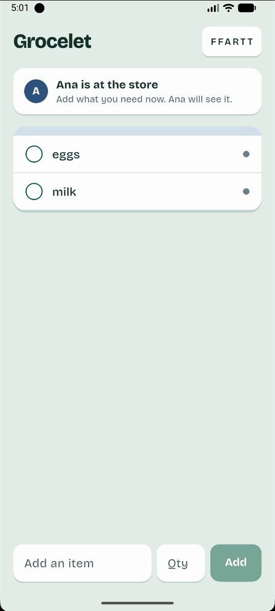
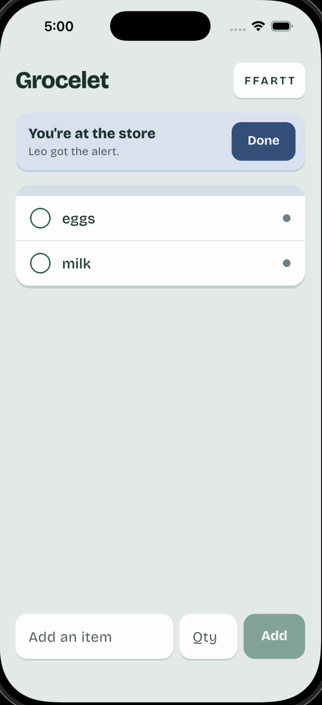
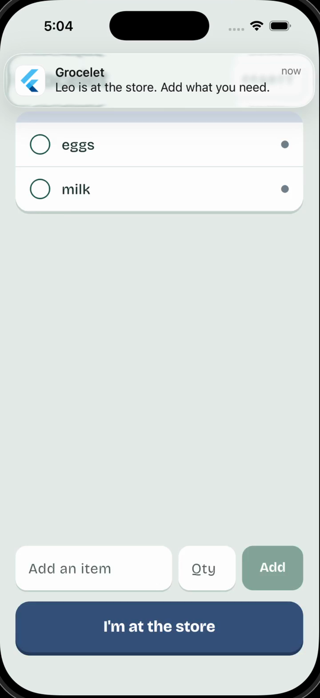

<div align="center">

<picture>
  <source media="(prefers-color-scheme: dark)" srcset="https://assets.appambit.com/logo-dark.svg">
  <source media="(prefers-color-scheme: light)" srcset="https://assets.appambit.com/logo-light.svg">
  
</picture>

<br><br>


# Grocelet — the whole house's grocery list (Flutter)

**One grocery list for everyone at home. Tap "I'm at the store" and everyone else gets a notification; whatever they
add while you shop shows up as New. Database, Cloud Code and Push on [AppAmbit](https://appambit.com) — no server of
your own, no login.**

App **02 / 07** of the *7 apps in 7 days* series.


[](https://www.facebook.com/profile.php?id=61583377906035)
[](https://www.instagram.com/appambit/)
[](https://www.youtube.com/@AppAmbit)

</div>

---

## Contents

- [What this is](#what-this-is)
- [Built prompt by prompt](#built-prompt-by-prompt)
- [Quick start](#quick-start)
- [Backend setup (AppAmbit)](#backend-setup-appambit)
- [How AppAmbit drives the app](#how-appambit-drives-the-app)
- [What's included](#whats-included)
- [Make it yours](#make-it-yours)
- [Project structure](#project-structure)
- [Commands](#commands)
- [Troubleshooting](#troubleshooting)
- [Learn more](#learn-more)
- [Follow AppAmbit](#follow-appambit)

## What this is

The grocery list used to live on the fridge door. **Grocelet** puts it in everyone's pocket:

- **No accounts.** Each phone identifies itself. One person creates a **house** and the rest join with its
  **6-letter code**.
- **One shared list** in the AppAmbit Database: add, check off, remove. iPhone and Android see the same list.
- **"I'm at the store".** One tap claims the trip (one shopper per house) and **AppAmbit Cloud Code pushes** everyone
  else: *"Ana is at the store. Add what you need."*
- **The New badge.** Anything added while someone is shopping shows up as **New** on the shopper's phone, right there
  in the aisle.
- **Online only.** No connection → *"No connection. Changes can't be saved right now."* Nothing is queued for later.

<div align="center">

| The house's list | "I'm at the store" | The others get the push |
|:---:|:---:|:---:|
|  |  |  |
| *Android: Ana is at the store.* | *iPhone: you're shopping, Leo got the alert.* | *The notification from AppAmbit.* |

</div>

> Real captures from an iPhone and an Android phone on the same house. Design: **"Fridge Door"** — the screen is the fridge, the list is a notepad stuck on it, people are magnets.
> Details in [DESIGN.md](DESIGN.md).

## Built prompt by prompt

The app was built with **three prompts** sent to a coding agent (Claude Code) with the **AppAmbit MCP** connected.
They are all in **[`prompts.md`](prompts.md)**, ready to paste:

| Step | Where | What it builds |
|---|---|---|
| 0 | By hand | The AppAmbit apps, their keys and the push credentials |
| 1 | Agent + AppAmbit MCP | The database and the cloud functions: join a house, and the "at the store" alert |
| 2 | Agent, Flutter | The house and the shared list on two phones |
| 3 | Agent, Flutter | "I'm at the store", the notification and the New badge |

## Quick start

**Prerequisites:** Flutter with Dart `^3.11`, Xcode and/or Android Studio, an
[AppAmbit account](https://appambit.com) with **Database**, **Cloud Code** and **Push** enabled, and a Firebase
project (Android push only).

```bash
git clone <your fork> grocelet && cd grocelet
cp .env.example .env     # fill in both App Keys
flutter pub get
flutter run
```

`.env` (git-ignored, never commit it):

```
APPAMBIT_IOS_APP_KEY=<your iOS app key>
APPAMBIT_ANDROID_APP_KEY=<your Android app key>
```

### Push credentials (by hand, once)

- **Android:** in Firebase add an Android app with your package, download `google-services.json` to `android/app/`
  (git-ignored). Then *Project settings → Service accounts → Generate new private key* and upload that JSON to your
  Android app in AppAmbit. AppAmbit's [FCM requirements](https://docs.appambit.com/push-notifications/fcm-requirements/)
  explain each step.
- **iOS:** in Apple Developer → Keys, create an APNs key (environment **Sandbox & Production**, so pushes also reach
  builds run from Xcode) and upload the `.p8` to your iOS app in AppAmbit with its Key ID, Team ID and bundle id.

## Backend setup (AppAmbit)

Run **prompt 1** of [`prompts.md`](prompts.md) with the AppAmbit MCP connected and the agent creates all of this.

### Database — `ShopListDb`

Linked to **both** apps, so an iPhone and an Android phone share a house.

| Table | Holds |
|---|---|
| `houses` | `code` (6 letters, unique), `shopper_id`, `shopping_since` |
| `members` | `nickname`, `platform` (ios / android), `consumer_id` (who to push) |
| `items` | `name`, `quantity`, `checked`, `added_by` |

Ids are uuids; dates always come from the database clock, never from the phone.

### Cloud Code

Deployed to **both** apps, each with an HTTP trigger of the same name. Full contract in
**[cloud_functions/README.md](cloud_functions/README.md)**.

| Function | Does |
|---|---|
| `join_house` | Creates a house (new code) or joins one by code, and saves the phone's AppAmbit consumer id |
| `start_shopping` | Claims the trip in one update (a trip older than 3 h can be taken over) and pushes every other member |
| `notify_members` | The relay: pushes the members of the *other* platform's app |

**Secrets** (dashboard → Env & Secrets, "Is secret"):

| Secret | On | Value |
|---|---|---|
| `OTHER_APP_KEY` | `start_shopping` | The App Key of the *other* platform's app |
| `RELAY_SECRET` | `start_shopping`, `notify_members` | Any long random value, the same everywhere |

Set `start_shopping` and `notify_members` to a **30 s timeout**: a push can take 8–10 s on a cold start.

## How AppAmbit drives the app

```
Phone A (iOS)                         AppAmbit                              Phone B (Android)
─────────────                         ────────                              ─────────────────
join_house ─────────────────────────► houses / members (+ consumer_id)
add "milk" ─────────────────────────► items ◄─────────────────────────────── list reload
"I'm at the store" ─► start_shopping ─┬─► push iOS members
                                      └─► notify_members (Android app) ───► 🔔 "Ana is at the store"
                                                                             add "eggs" ──► items
list shows "eggs" · New ◄─────────────────────────────────────────────────────────────────┘
```

`ctx.appambit.push` only reaches phones of the AppAmbit app the function runs in. With one app per platform,
`start_shopping` pushes its own platform and asks the other app's `notify_members` to push the rest.

## What's included

| Area | Where |
|---|---|
| Create / join a house with a code, nickname | `lib/features/house/` |
| The shared list, check off, the New badge, "I'm at the store" | `lib/features/list/` |
| AppAmbit Cloud Code, Database, Push and Analytics | `lib/core/appambit/` |
| Fridge Door theme and shared widgets | `lib/core/theme/`, `lib/core/widgets/` |
| Cloud Code sources and tests | `cloud_functions/` |

## Make it yours

- **App keys** — your own, in `.env`.
- **App name** — `ios/Runner/Info.plist` (`CFBundleDisplayName`) and `android/app/src/main/AndroidManifest.xml`
  (`android:label`).
- **Bundle id / applicationId** — `com.kavaup.grocelet` (`android/app/build.gradle.kts`, Xcode). It must match your
  Firebase app and your APNs key.
- **Icon** — replace `assets/icon/icon.png` (+ `icon_foreground.png`) and run `dart run flutter_launcher_icons`.
- **Push copy** — the message lives in `cloud_functions/start_shopping.mjs`.

## Project structure

```
lib/
  main.dart
  core/
    appambit/          # cloud_service · db_service · push_service · analytics
    theme/             # Fridge Door tokens
    widgets/           # notepad, magnets, buttons, banners
  features/
    house/             # create / join a house
    list/              # the shared list and the store trip
cloud_functions/       # join_house · start_shopping · notify_members + tests
test/                  # unit and widget tests
```

## Commands

| Command | Does |
|---|---|
| `flutter pub get` | Install dependencies |
| `flutter run` | Run on a device or simulator |
| `flutter analyze` | Lint |
| `flutter test` | Dart tests |
| `node --test cloud_functions/*.test.mjs` | Cloud Code tests against an in-memory SQLite |
| `dart run flutter_launcher_icons` | Regenerate the app icon |

## Troubleshooting

| Symptom | Fix |
|---|---|
| Only phones of one platform get the push | `OTHER_APP_KEY` or `RELAY_SECRET` missing or different between apps. |
| `start_shopping` times out | Raise the function timeout to 30 000 ms. |
| The push shows up late | AppAmbit can keep a Cloud Code push "Scheduled" for up to ~2 minutes. |
| No push on iOS from Xcode | The APNs key must be **Sandbox & Production**. |
| No push on Android | `google-services.json` missing in `android/app/`, or the service account JSON wasn't uploaded to AppAmbit. |

## Learn more

- [prompts.md](prompts.md) — the three prompts the app was built with
- [cloud_functions/README.md](cloud_functions/README.md) — every function's contract
- [DESIGN.md](DESIGN.md) — the look
- [AGENTS.md](AGENTS.md) — rules for coding agents
- [AppAmbit](https://appambit.com) · [AppAmbit docs](https://docs.appambit.com) · [Flutter docs](https://docs.flutter.dev)

## Follow AppAmbit

New apps every week, built on AppAmbit with an AI agent:

- **Facebook** — [facebook.com/AppAmbit](https://www.facebook.com/profile.php?id=61583377906035)
- **Instagram** — [@appambit](https://www.instagram.com/appambit/)
- **YouTube** — [@AppAmbit](https://www.youtube.com/@AppAmbit)

---

<div align="center"><sub>Built with Flutter + AppAmbit. Swap the App Keys and it's yours.</sub></div>
